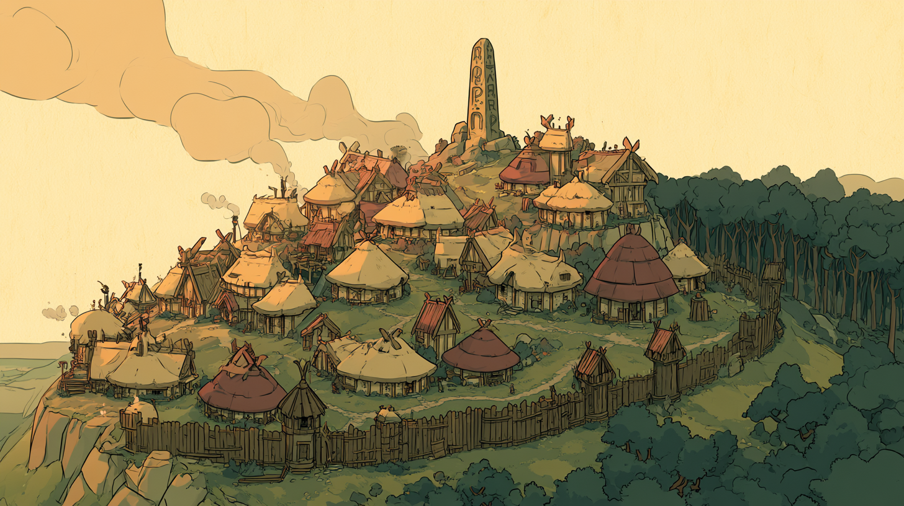
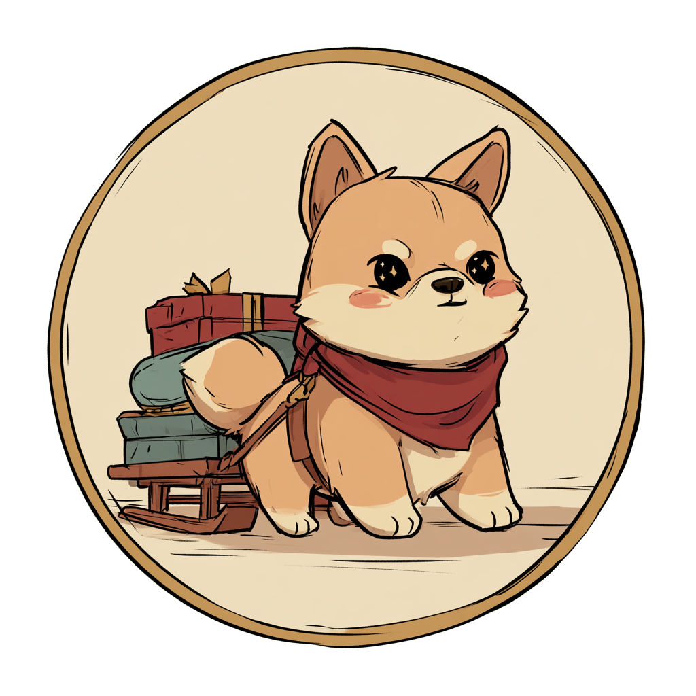
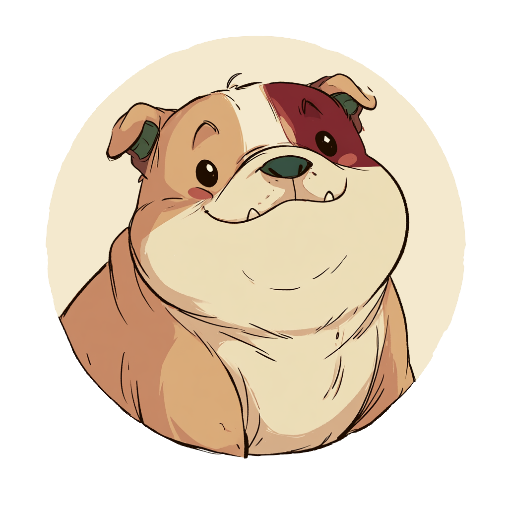

  

<h1 align="center">Sled Dog — Community Stonetop content</h1>

<em>Player-made arcana, items, steading improvements, NPCs, groups, locations, followers, and expeditions for <a href="https://sleddog.tools">Sled Dog</a>.</em>

  
  

This repository collects **third-party, unofficial** content for _Stonetop_ (by Jeremy Strandberg), submitted by the community. Anything merged here can be pulled into **[Sled Dog](https://sleddog.tools)** — the Stonetop companion app — and offered to any table that turns on third-party content, **credited to its author with a link back**.

Want to add your own arcanum, item, steading improvement, NPC, group, location, follower, or expedition — with your own art alongside it? See **[CONTRIBUTING.md](CONTRIBUTING.md)**. It takes a fork, a filled-in template, and a pull request that a GitHub Action checks for you.

> **Unofficial, fan-made work.** Not affiliated with, endorsed by, or sponsored by Lampblack & Brimstone or Jeremy Strandberg. You'll need a copy of _Stonetop_ to use this material.

---

## What's in here

- **[`content/`](content/)** — the submitted content, organized **by game system** (`content/<system>/<kind>/<slug>/`). Systems: `stonetop/` (arcana, items, steadings, npcs, groups, locations, followers, expeditions) and `forged/` (scores, factions, npcs, districts, items). Every kind can ship an `art/` folder whose images land on the party's image gallery — see [CONTRIBUTING.md](CONTRIBUTING.md#shipping-art-with-your-content).
- **[`templates/`](templates/)** — fill-in-the-blank starting points for each kind, under `templates/<system>/`.
- **[`schema/`](schema/)** — the JSON Schema each submission must satisfy (the contract Sled Dog reads), under `schema/<system>/`.
- **[`CONTRIBUTING.md`](CONTRIBUTING.md)** — how to submit.

## Play it in Sled Dog

  

Content here comes to life in **[Sled Dog](https://sleddog.tools)** — the Stonetop companion for character sheets, arcana, and your steading. Turn on third-party content in a party's settings and your submissions show up right in the pickers, credited to you.

  

## Support Pup Pup Games

Sled Dog and this content pipeline are made by **[Pup Pup Games](https://puppup.games)**. If you'd like to help us keep building:

  
  

## Get Pup Pup Games' own Stonetop content

We publish our own free, open-text Stonetop expeditions and modules too:

- **Free text** — [Pup-Pup-Games/Stonetop-Resources](https://github.com/Pup-Pup-Games/Stonetop-Resources)
- **Print-ready PDFs** — [pup-pup-games.itch.io](https://pup-pup-games.itch.io)

## Need help?

Having trouble contributing, or the validator won't go green? **[Contact us →](https://puppup.atlassian.net/servicedesk/customer/portal/1/group/4/create/21)** — we're glad to help.

---

   
  <em>Pup Pup Games. Silly games for serious fun.</em>

